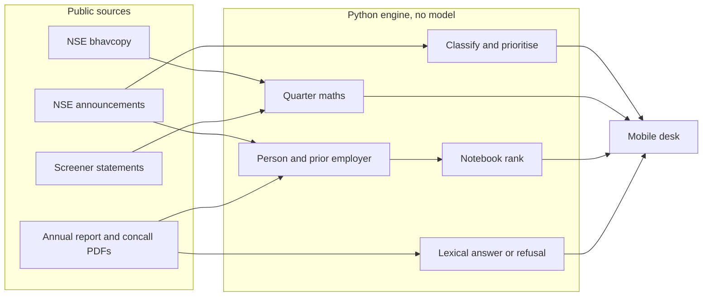

# FINN — covering note

Abhiram Dharme · IIT Delhi
Subject: IIT Delhi – Founding AI Engineer - 2027

## What I built

FINN is the morning desk of one investor, Meera Shah. She opens it to be told what changed, why it matters, and who in her own notebook can help her understand it. She does not browse a feed.

The book is 18 NSE names across banks, IT, pharma, autos, chemicals, electronics and consumer, plus five she does not own (Eternal, Kaynes, SRF, Varun Beverages, Tata Motors CV) so on-demand research is not the portfolio in disguise. The engine is the same function for a symbol she has never saved. The cache is just the book, already read, so the desk opens at once.

## The point of view

An investor's scarce resource is attention, not information. So the default screen is a lede, not a dashboard.

- The last 24 hours is the default window. On a quiet morning the desk says so, and points at the last thing that did need her.
- Price and volume are a separate line from filings. She sets both thresholds. A move with no filing is labelled as unexplained.
- 8 November 2026 was a thin session (about a fifth of normal volume, consistent with a muhurat print). The line is drawn on the previous full close, 6 November, and the desk says why. That session is where ICICI closed +4.7% on 2.6× volume with no filing, and HDFC Bank, Titan and Hindalco also broke the line.
- Routine paper — newspaper ads, ESOPs, trading windows — is counted and collapsed.
- A management card quotes the filing. V. N. Srivatsan's appointment as HDFC Bank's Chief Compliance Officer carries the biography the letter itself gives, including that he came from ICICI Bank. Ishita Banerjee in the notebook has been at ICICI since 2017. The card says "same institution, not a confirmed introduction." A shared employer is not a friendship, and the product refuses to pretend otherwise.
- Leo Puri's letter does not repeat his profile. The card says so, instead of inventing one, and still tells her he becomes chairman on 23 January 2027 when R. Seshasayee's term ends. Mehul Shah was in Asian Paints finance until 2020. He is context on the company, not on Puri. The card says that too.

On the company page the discipline is the one in the brief. Numbers come from the filed statements. Narrative comes from the annual report and the concall transcripts. A percent in a transcript becomes a verdict only when the sentence is forward-looking and the number sits next to the metric. "Revenue grew 22%" is a result, not guidance, and it is not scored. Lenders do not report EBITDA. HDFC's financing-profit line is not comparable, so it is omitted and the omission is labelled. Segment names are shown. The rupee split is paywalled on the source I use, so the mix is not invented.

## Decisions

**The model is not on the critical path.** Classification, the four headline numbers, QoQ and YoY, cash conversion, the network rank and the answer to a question are all deterministic. A wrong PAT is worse than a blunt sentence. An optional model can be placed later in front of retrieved chunks. It is not allowed to introduce a number. Nothing in the running demo calls an LLM, which is also why a reviewer can open it with no key and no spend.

**Retrieval is lexical, over the pages actually loaded.** Eighty chunks of a report do not need a vector database. If the question is not in those pages, FINN refuses. That refusal is the feature.

**Primary documents only, on the pull side.** Screener is used as a structured reading of the filed statements, and the filing or the annual report is linked beside it. Screener's own AI summaries are not used. Push-side biography is the text of the filing, not a scraped profile.

**The network is synthetic, and labelled.** Twenty-three people, built so the notebook overlaps the book: a Pidilite salesperson, an ex-SRF engineer, a Motherson supplier to Tata Motors and Maruti, an ICICI banker, someone who used to run HDFC business banking. For a real deployment the investor would upload a notebook — meetings, employers, colleges — or a consented archive. I would not scrape LinkedIn.

**NSE over Yahoo.** Yahoo Finance was returning 429. The official cash-market bhavcopy is the end-of-day print the brief asked for, and one file is the whole market, so a symbol she did not pick still has a price history. BSE's API was blocked. Filings come from NSE's announcements feed. Transcripts and annual reports are the PDFs those feeds and Screener point at.

## Architecture

Pipelines. A single `python -m finn.pipeline` walks bhavcopies, filings, statements, management-letter PDFs and the last few concalls plus the opening of the annual report. Facts are cached as JSON. Judgment — what is material, who to call, whether a sentence was guidance — stays in code, so a copy change does not require a refetch. Name matching is conservative: a normalised employer string must contain the other, which is why ICICI Bank matches ICICI Bank Limited and does not match ICICI Prudential.

Security and privacy. The demo is one tenant, and the notebook is fiction. In a real deployment the notebook is private to that investor: encrypted at rest, never joined to another user's graph, deleted when they delete the person, and never used to train a model. A filing is matched to the notebook inside their boundary. If a model is added, it receives the filing excerpt and the top few candidate people, not the whole book. Consent is an upload, not a scrape. Access is the investor's login, with an audit line when a person is surfaced against a filing.

LLMs and agents. No agent loop. The steps that look like judgment — materiality, link strength, "is this guidance" — are rules, because they have to be inspectable and they have to be cheap. The place a model would earn its cost is prose over already-extracted quotes, and only there. Bulk extraction stays with the parser. That is the routing decision, taken by not spending.

Cloud. The desk is one container: FastAPI serving the mobile page and the API. The cache ships with it, so a cold start does not depend on NSE being polite. Live reads for a new symbol run in the same process. I would put that container in Mumbai, close to the exchange, with the cache on a private disk and the notebook in a separate encrypted store. The fetcher is the only thing that needs to reach the public internet.

## Left out, on purpose

Intraday prices. The brief asked for end of day, and an intraday tape would undo the calm. Delivery channels — mail, a push notification — are a transport in front of the same brief, not a second product. Voice is the same: the command line at the top already routes "who knows specialty chemicals" and a ticker; speech would sit on that router. Multi-user auth is described above and not built, because a login wall on a single demo notebook teaches nothing. A model, until it can be constrained to the retrieved pages.

## Where it goes next

The management letter often says the profile was in an earlier filing. The next step is to follow that reference inside the same symbol's filings, still without leaving the primary document. After that, a watched line that remembers why she moved a threshold, and a reconnect that drafts one sentence she can actually send — from the filing, not from a template with her name glued on.

## How the build went

Yahoo Finance was the suggested starting point and it was rate-limiting, so the price source became the NSE bhavcopy. BSE's API returned 403, so announcements stayed on NSE, which was happy to return JSON. The first pass treated "revenue grew 22%" as guidance and scored a miss. That was wrong, and the rule is now that a past result cannot be a promise. Bank "EBITDA" was a negative financing-profit line. It is no longer shown. The thin session on 8 November would have made every volume alert meaningless. It is skipped, and labelled. Those three corrections are the difference between a demo that looks finished and one an investor would trust.
